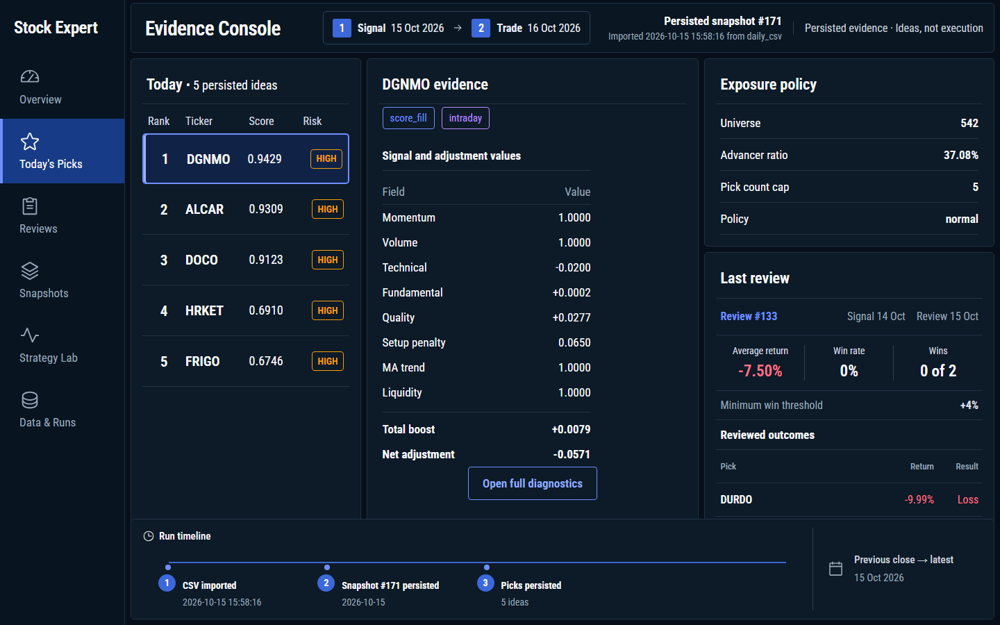
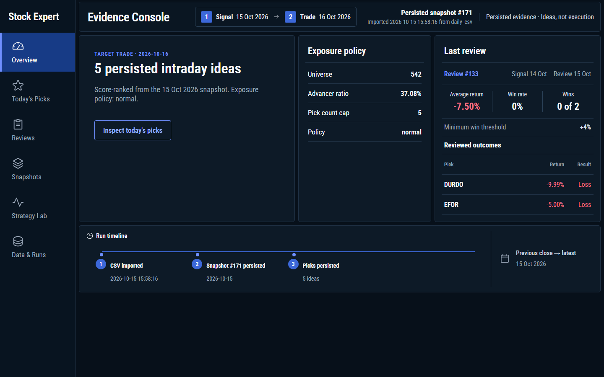
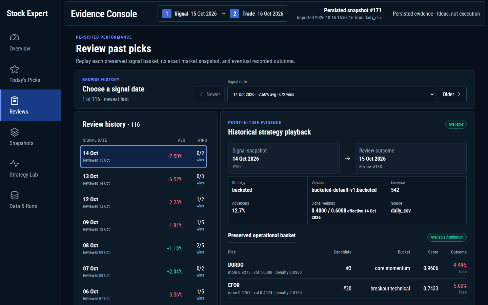
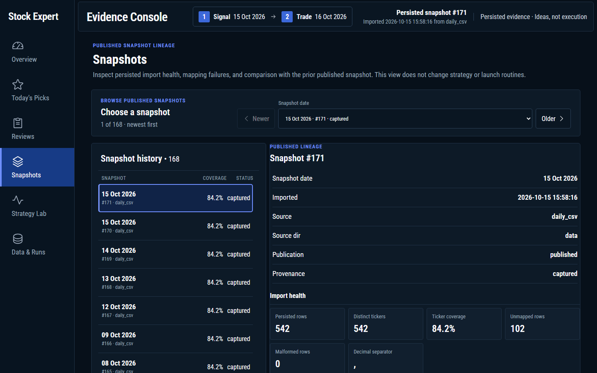
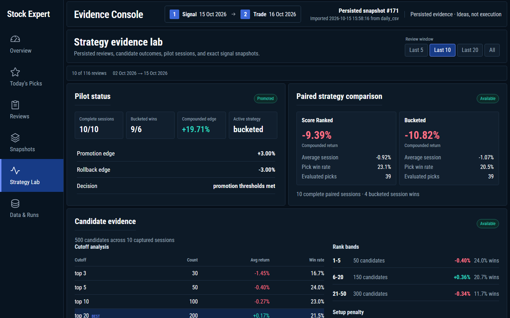
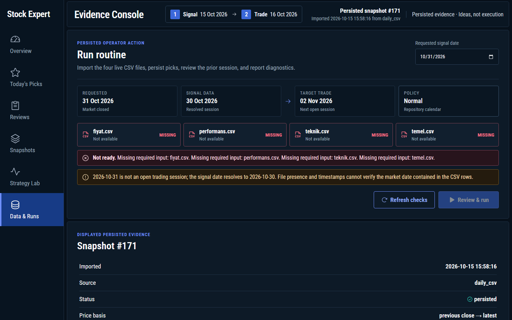

# Stock Expert

## Frontend Prototype

The approved dark Evidence Console lives in `frontend/`. Evidence panels read persisted loopback APIs (`/api/picks/latest`, reviews, strategy evidence, snapshots). Data & Runs executes the real persisted routine through the same loopback-only Python API.

```powershell
cd frontend
npm install
npm run dev
```

Open `http://127.0.0.1:5173/?view=runs`, review the resolved signal/trade dates and four CSV checks, then confirm the persisted routine. The button remains disabled when an input is missing, empty, or stale. In Codex, `/stock-expert:refresh-data` refreshes and validates the live CSV bundle before opening Data & Runs; `/stock-expert:run` only starts or reuses the app.

### Screenshots

**Today's Picks**: the ranked basket for the target trade date, per-pick signal evidence, exposure policy, and the last review.



**Overview**: snapshot, signal/trade dates, exposure policy, last review outcome, and the run timeline.



**Reviews**: browse past signal baskets and replay each one against its exact snapshot and recorded outcome.



**Snapshots**: published import lineage, import health, and mapping failures.



**Strategy Lab**: pilot status, paired score-ranked vs bucketed comparison, and candidate cutoff evidence.



**Data & Runs**: CSV readiness checks and the persisted routine launcher.



Python CLI for BIST intraday idea generation and review.

Current runtime mode: daily CSV snapshots.

## Start Here

- Durable repo memory: [memory.md](memory.md)
- Current task: [docs/tasks/current.md](docs/tasks/current.md)
- Project context: [docs/context/project.md](docs/context/project.md)
- Output rules: [docs/rules/output.md](docs/rules/output.md)
- Architecture: [docs/context/architecture.md](docs/context/architecture.md)
- Decisions: [docs/context/decisions.md](docs/context/decisions.md)

## Commands

Run these from the repo root.

```powershell
python.exe -m stock_expert import-daily-folder --folder data\20260414
python.exe -m stock_expert refresh-investing-csvs
python.exe -m stock_expert review --date 2026-04-21 --dry-run
python.exe -m stock_expert routine --date 2026-04-21
python.exe -m stock_expert daily --date 2026-04-14
python.exe -m stock_expert picks --date 2026-04-14
python.exe -m stock_expert review --date 2026-04-14
python.exe -m unittest discover -s tests -v
```

## Tests

Run these from the repo root.

```powershell
python.exe -m unittest discover -s tests -v
```

## Data

- SQLite: `data/stock_expert.db` on `main`; branch-specific DBs on non-`main` branches unless `STOCK_EXPERT_DB_PATH` is set
- Local `.env` can set `STOCK_EXPERT_DB_PATH`, for example see [.env.example](.env.example)
- Daily CSV inputs: `fiyat.csv`, `performans.csv`, `teknik.csv`, `temel.csv`
- Optional ticker override map: `data/ticker_map.csv`

## Git Workflow

- `main` is the stable/default branch
- use short-lived feature branches for larger work, then merge back into `main`
- push `main` to GitHub after merges so the remote stays current
- remote repo: [beagle1903/stock-expert](https://github.com/beagle1903/stock-expert)

## Notes

- Feature docs live in [docs/features](docs/features)
- Scratch files live in [docs/scratch](docs/scratch) and should not be edited during normal task work
- Root guidance lives in [AGENTS.md](AGENTS.md)
